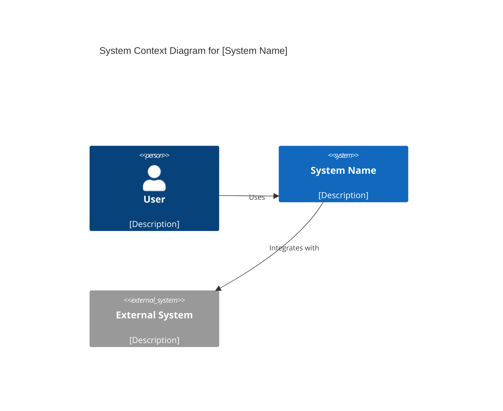

# Generation Guide: TECH-04 C4 Context Diagram

**Purpose:** Visualize the software system as a whole, showing its interactions with users and other systems.

---

## Prerequisites
- PROD-01 Product Vision

## Questions to Ask the User
- What are the primary user roles?
- Which external systems (APIs, third-party services) does the system integrate with?
- What is the primary value flow through the system?

## Document Template

```markdown
# C4 Context Diagram: [System Name]

**ID:** TECH-04
**Version:** 1.0
**Status:** Draft
**Created:** [Date]
**Dependencies:** PROD-01
**Gateway:** No

---

## Diagram


## Element Catalog
- **Users:** [List]
- **Internal Systems:** [List]
- **External Dependencies:** [List]
```
