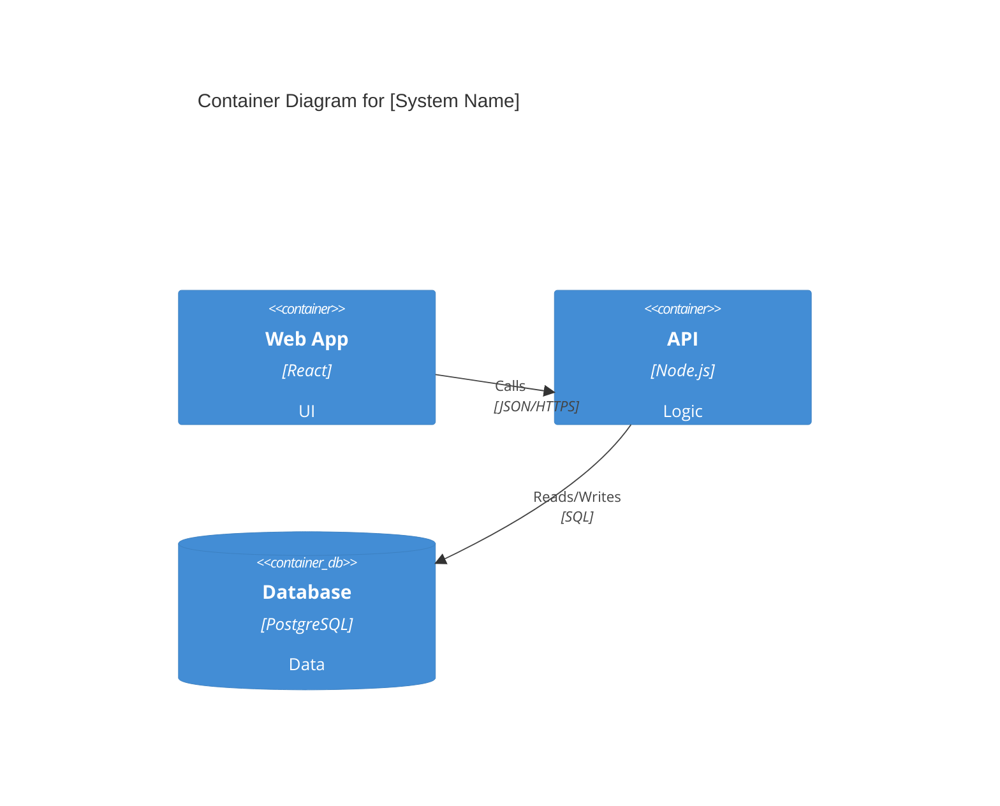

# Generation Guide: TECH-05 C4 Container Diagram (GATEWAY)

**Purpose:** Zoom into the system to show the high-level technology choices (applications, databases, message brokers).

---

## Prerequisites
- TECH-04 C4 Context Diagram

## Questions to Ask the User
- What are the major deployable units (Web App, API, Mobile App)?
- What data stores are being used?
- How do these containers communicate (REST, gRPC, MQ)?

## Document Template

```markdown
# C4 Container Diagram: [System Name]

**ID:** TECH-05
**Version:** 1.0
**Status:** Draft
**Created:** [Date]
**Dependencies:** TECH-04
**Gateway:** Yes

---

## Diagram


## Container Inventory
| Container | Tech | Purpose |
|---|---|---|
| | | |

## Gateway Approval
**Required Approver:** Architect
```
