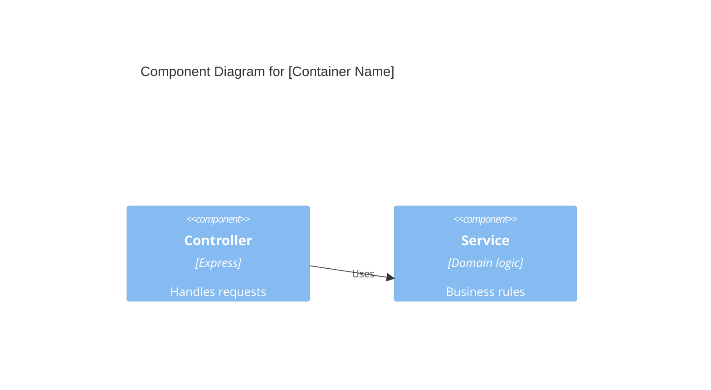

# Generation Guide: TECH-06 C4 Component Diagram

**Purpose:** Break down a single container into its internal components, showing interfaces and responsibilities.

---

## Prerequisites
- TECH-05 C4 Container Diagram

## Questions to Ask the User
- Which container needs a deeper breakdown?
- What are the major modules or services within that container?
- What is the internal data flow between components?

## Document Template

```markdown
# C4 Component Diagram: [Container Name]

**ID:** TECH-06
**Version:** 1.0
**Status:** Draft
**Created:** [Date]
**Dependencies:** TECH-05
**Gateway:** No

---

## Diagram


## Component Catalog
- **[Component Name]:** [Responsibility]
- **[Component Name]:** [Responsibility]
```
