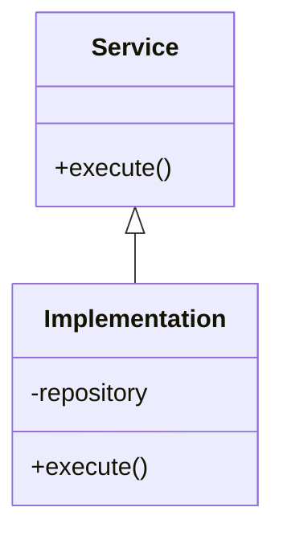

# Generation Guide: TECH-07 C4 Code Diagram

**Purpose:** Visualize implementation details at the class or interface level for complex components.

---

## Prerequisites
- TECH-06 C4 Component Diagram

## Questions to Ask the User
- Which specific component needs a low-level implementation view?
- What are the key classes or interfaces?
- What design patterns (e.g., Factory, Strategy) are being implemented?

## Document Template

```markdown
# C4 Code Diagram: [Component Name]

**ID:** TECH-07

---

## Diagram


## Implementation Details
- **Pattern:** [e.g., Dependency Injection]
- **Interfaces:** [List]
```
