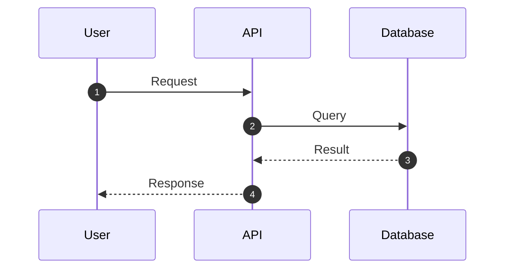

# Generation Guide: TECH-09 Sequence Diagrams

**Purpose:** Visualize the chronological interaction between actors and system components for specific scenarios.

---

## Prerequisites
- TECH-02 TDD

## Questions to Ask the User
- Which specific user flow or system process needs visualization?
- What are the major components involved?
- What are the key success and failure paths?

## Document Template

```markdown
# Sequence Diagram: [Scenario Name]

**ID:** TECH-09
**Version:** 1.0
**Status:** Draft
**Created:** [Date]
**Dependencies:** TECH-02
**Gateway:** No

---

## Scenario Logic


## Detailed Flow Breakdown
1. [Step 1 description]
2. [Step 2 description]
```
