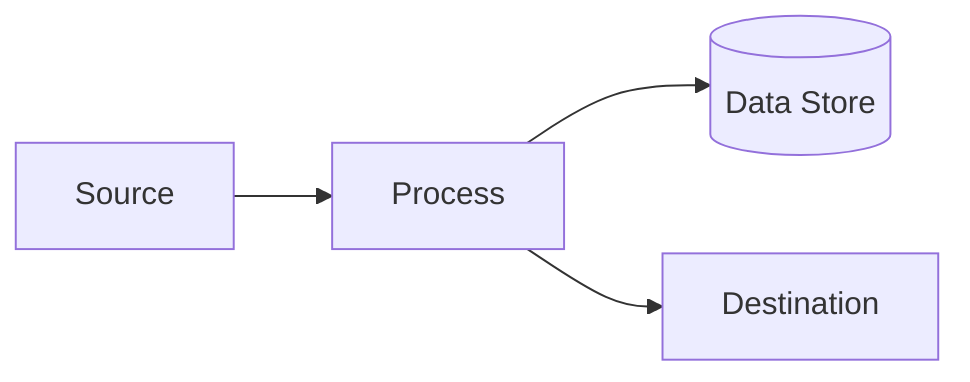

# Generation Guide: TECH-10 Data Flow Diagrams

**Purpose:** Map the movement and transformation of data through the system, focusing on data stores and processes.

---

## Prerequisites
- TECH-02 TDD

## Questions to Ask the User
- Where does data originate?
- What are the major processes that transform data?
- Which data stores (databases, files, queues) are involved?

## Document Template

```markdown
# Data Flow Diagram (DFD): [Process Name]

**ID:** TECH-10
**Version:** 1.0
**Status:** Draft
**Created:** [Date]
**Dependencies:** TECH-02
**Gateway:** No

---

## Level 1 DFD


## Element Dictionary
- **Processes:** [List]
- **Data Stores:** [List]
- **Flows:** [List]
```
