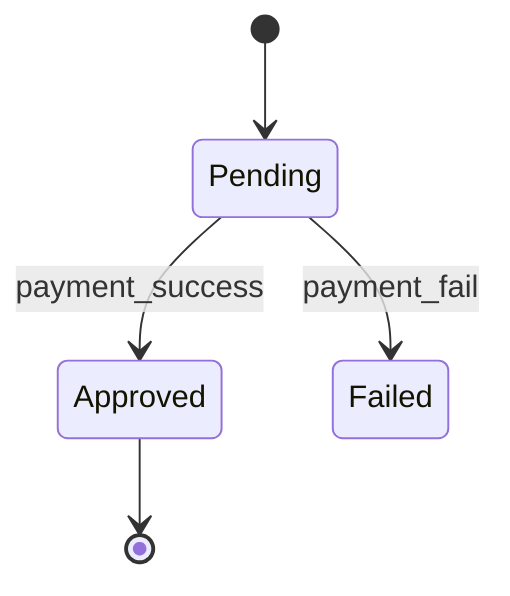

# Generation Guide: TECH-11 State Diagrams

**Purpose:** Visualize the lifecycle and state transitions of a specific entity or process.

---

## Prerequisites
- TECH-02 TDD

## Questions to Ask the User
- What is the entity being modeled (e.g., Order, User Session)?
- What are the possible states?
- What triggers the transition from one state to another?

## Document Template

```markdown
# State Diagram: [Entity Name]

**ID:** TECH-11

---

## Diagram


## State Dictionary
- **[State Name]:** [Description]
- **[State Name]:** [Description]

## Transition Rules
| From | To | Trigger |
|---|---|---|
| | | |
```
